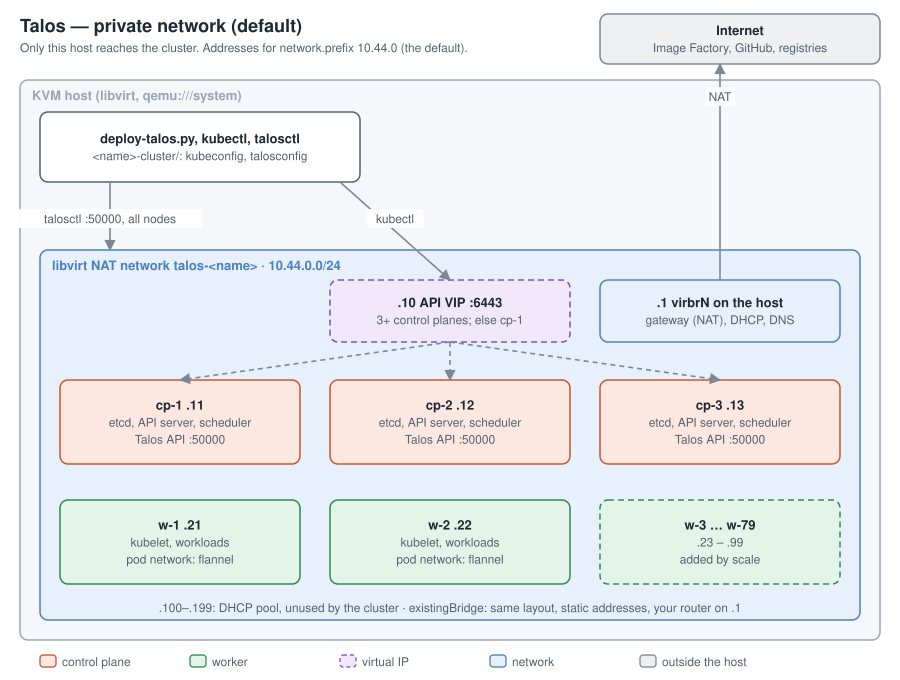
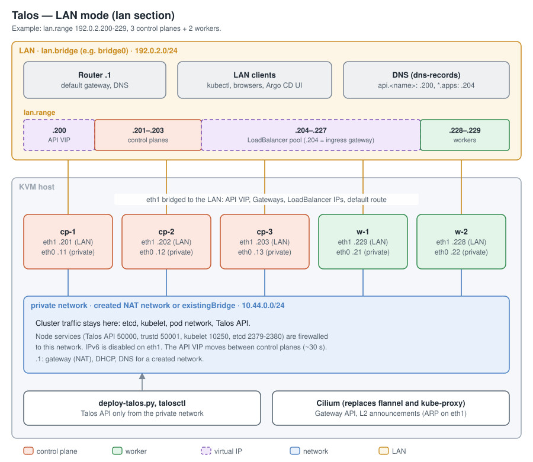
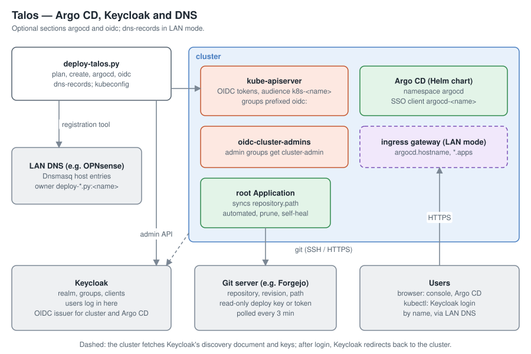

# Architecture

> Explanation · [Documentation](../../README.md#documentation)

How `deploy-talos.py` turns a cluster file into a running cluster, and why it
is built the way it is. To build one: [Getting started](../tutorials/getting-started.md).

## The cluster file is the source of truth

A cluster is described by one YAML file ([reference](../reference/cluster-file.md)).
Every command reads it and makes the cluster match: `scale` compares the
worker VMs that exist with `workers.count`, `upgrade` compares each node's
Talos version with `talos.version`, `argocd` re-renders the add-ons. Unknown
keys are rejected so that a typo fails instead of being ignored, and the file
holds no credential, only the names of files that do: it can be committed.

The script assumes no location of its own. Everything it reads or writes is
set in the file or derived from it, which is what lets one host run several
clusters side by side.

## Topology

**Private network (default).** The script creates a libvirt NAT network for
the cluster. Only this host reaches the nodes.

**LAN mode.** Each node gets a second NIC on a host bridge. The API VIP, the
ingress gateway and LoadBalancer services take addresses from `lan.range`,
while cluster traffic stays on the private network. Details:
[LAN mode](lan-mode.md).

**Integrations.** What the `argocd` and `oidc` sections and `dns-records`
connect: [GitOps and add-ons](gitops.md), [Authentication](authentication.md),
[Register DNS records](../how-to/register-dns-records.md).

The diagrams are generated by `docs/diagrams.py`.

## From file to cluster

- **Image.** The Talos `nocloud` image is built by the Image Factory for the
  configured extensions (`talos.extensions`), so a different extension list
  means a different, separately cached image. The qemu-guest-agent extension
  gives libvirt graceful shutdown and address reporting.
- **Config delivery.** Each node's machine config goes onto a small ISO as
  cloud-init user-data. Nodes boot fully configured: there is no
  maintenance-mode `apply-config` step to race against.
- **Install target.** The configs point the installer at `/dev/vda` with the
  `nocloud-installer` image of the same extension set, so a later
  `talosctl upgrade` keeps the extensions.
- **Bootstrap.**
  1. Bootstrap is retried until Talos accepts it.
  2. The kubeconfig is fetched.
  3. In LAN mode, the Gateway API CRDs and Cilium are installed: nodes can't
     become Ready without a CNI.
  4. `talosctl health` waits for etcd, the control plane and schedulability.
  5. The script checks with `kubectl` that all nodes are Ready and CoreDNS is
     available. With Cilium, `talosctl health` reports those two as SKIP,
     because Talos doesn't manage the CNI.
- **Autostart.** VMs and the created network are set to autostart, so the
  cluster comes back after a host reboot, provided libvirt's daemons start at
  boot ([Prepare the host](../how-to/prepare-the-host.md)).
- **Secrets are kept.** The cluster directory holds the PKI. `destroy` leaves
  it, and `create` reuses it, so a rebuilt cluster keeps its certificates and
  tokens.

## The address plan

Node addresses are fixed by role and index ([reference](../reference/address-plan.md)),
so a node's address never depends on creation order and a rebuilt cluster
gets the same addresses.

In LAN mode, workers are numbered from the *end* of `lan.range`. Scaling
workers then only moves the *upper* bound of the LoadBalancer pool, and since
Cilium hands out pool addresses from the bottom, addresses already given to
services never move.

## The health gate

Everything that takes nodes down one at a time (`upgrade`, `upgrade-k8s`,
`oidc`, `headlamp`, `longhorn`) waits between nodes for the same gate:

- `talosctl health`: etcd members and health, Talos API, kubelet, boot
  sequence, control-plane static pods and components;
- all Kubernetes nodes Ready;
- CoreDNS available;
- every DaemonSet in `kube-system` fully rolled out;
- with Longhorn, every attached volume `healthy`.

The same gate must pass before the first node, so an unhealthy cluster is
never touched.

## Related

- [Commands](../reference/commands.md): what each command does, step by step.
- [Upgrades](upgrades.md), [LAN mode](lan-mode.md), [GitOps and add-ons](gitops.md).
